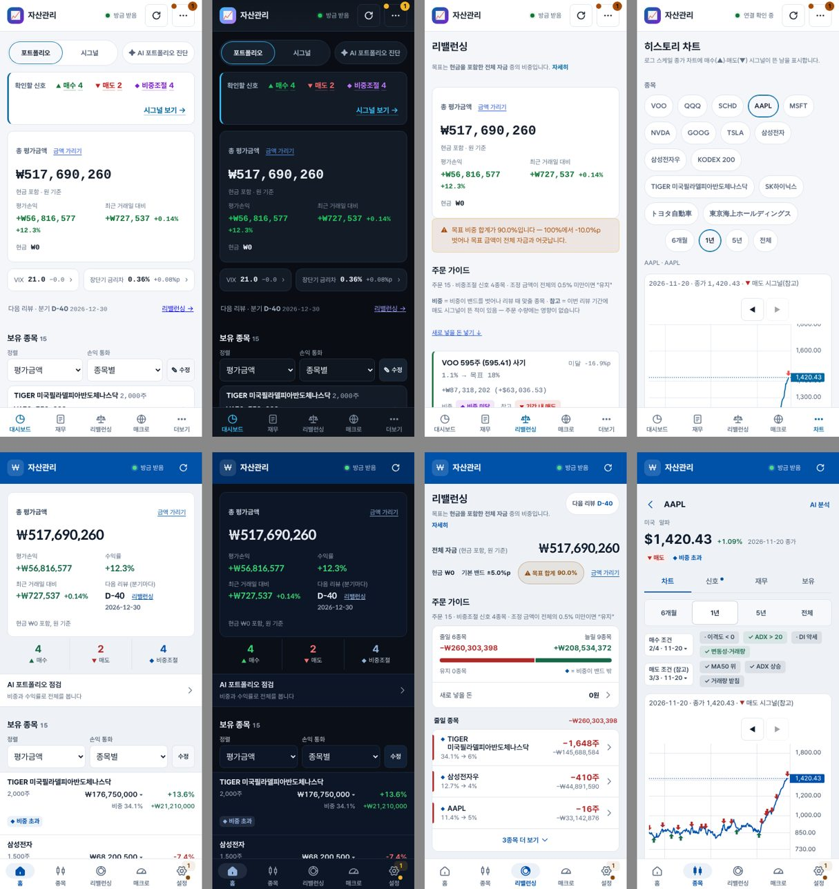
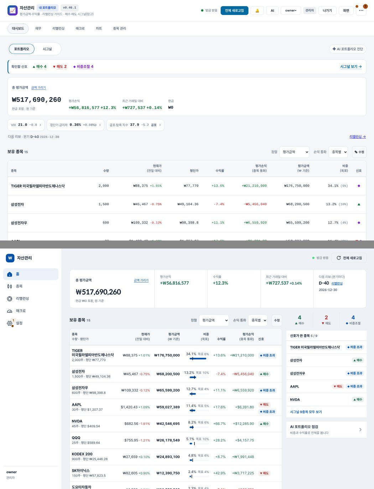

# 디자인 4차 — 끝 보고 (0.47.0)

## 한 문단

앱을 **처음부터 다시 그렸습니다.** 화면마다 목업을 먼저 보여 드리고 고르신 것만 넣었습니다(목업 01~15). 색은 청람 한 색과
먹빛 글자, 글꼴은 Pretendard(맨 위 요약 숫자만 Spoqa)입니다. 탭은 홈 · 종목 · 리밸런싱 · 매크로 · 설정 다섯 개로 정리했습니다
(폰은 아래, PC 는 왼쪽). 홈은 총액과 매수 · 매도 · 비중조절 칸을 맨 위에 두고, 종목은 줄이나 카드로 골라 봅니다. 종목을 누르면
차트 · 신호 · 재무 · 보유 네 탭이 나옵니다. 리밸런싱은 줄일 종목과 늘릴 종목을 부호 주수와 색 띠로 나눴고, 매크로는 한 목록에 ★ 로
"내 지표"를 모읍니다. 손님 첫 화면은 매크로가 먼저, 처음 온 사람의 홈은 세 단계 안내입니다. "AI가 만든 티"(똑같은 둥근 카드,
가운뎃점 나열, 반짝이, Tailwind 기본 색)도 함께 걷어냈습니다. **안 한 것**: 시그널 · 비중 계산과 저장은 그대로입니다. 서버는
일본 종목 이름을 한글로 바꾼 것 하나만 고쳤습니다(주인 요청). 차트를 손가락으로 눌러 값을 읽는 것 같은 몇 가지는 다음 차수로 넘깁니다(아래 표).

## 전후 비교

`shots/전후-폰.jpg` — 위가 전(79b8850), 아래가 지금. 왼쪽부터 홈 라이트 · 홈 다크 · 리밸런싱 · 종목 차트(전: 히스토리 차트, 지금: 종목 안).

`shots/전후-PC.jpg` — PC 1400 홈. 위가 전, 아래가 지금.

## 묶음과 주인이 고른 것

| 묶음 | 목업 | 고른 것 | 판정 |
| --- | --- | --- | --- |
| 1 전역 | 01~05c | 배치 B · 큰 총액 · Pretendard + 요약 숫자 Spoqa · 청람 #0051a8 · 매수 초록 · 매도 빨강 · 비중 청람(상승 빨강이면 따라감) | `1-review*.md`(다섯 번째 조건부 — 조건 보완 뒤 ② 승인) · `1-user.md` |
| 2 뼈대 | 06~10 | 위 탭 없이 신호 칸으로 · 탭 다섯(B) · 아이콘 둥근 선 · PC 왼쪽 메뉴 · 시그널 목록 접힌 카드(하나씩) | `2-review*.md`(재검토 조건부 — 조건 보완 뒤 ② 승인) · `2-user.md` · `2-보완.md` |
| 3 종목 | 11 | 줄/카드 사용자가 고름 · 종목 안 위 탭 넷 · 잡고 끌어 순서 | `3-review*.md`(여덟 번째 합격) · `3-user.md` · `3-보완.md` |
| 4 리밸런싱 | 12 · 12b · 12c · 12d · 13 | 12c(부호 주수 + 왼쪽 띠, 목표 · 밴드 한 시트) · AI 티 빼기(청람 먹 · 카드 위계 · 단추 셋 · 글) | `4-review*.md`(열 번째 합격) · `4-user*.md` · `AI티-점검.md` |
| 5 매크로 | 14 | ★ = "내 지표" 맨 위 · 풀이 한 줄 + 예상치는 차트 창 안 · "2026년 10월분" | `5-review*.md`(다섯 번째 합격) · `5-user.md` |
| 6 손님 · 처음 온 사람 · 빈 화면 | 15 | 빈 화면 점선 상자 그대로 · 처음 온 사람 새싹 그림 + 짧은 세 단계 · 손님 매크로 목록 먼저 · 글 9곳 | `6-review*.md`(세 번째 합격) · `6-user.md` |

목업 원본과 주인 답은 `docs/design/mockups/README.md` 의 "4차" 표에 있습니다.

## 수치

| | 시작 (79b8850) | 끝 |
| --- | --- | --- |
| 자동 검사 `audit.mjs` | 285조합: 외톨이 16 · 숫자 갈라짐 12 · 가짜 단추 9 · 360 두 줄 2 · 나머지 0 | AUDIT_RESULT |
| 프런트 테스트 | 1065 | **1178** (지운 것 없음) |
| 백엔드 테스트 | 1609 (+5 skip) | **1611** (+5 skip) |
| lint 경고 · `tsc -b` | 22 · 통과 | **19** · 통과 |
| 색표 밖 색 | — | 0 (`tokens.test.ts` 가 막음 — 라이트 색은 Tailwind 기본값이 아니고 대비 4.5 이상) |
| 처음 받는 글꼴 | Wanted Sans 297KB | Pretendard 300KB (요약 숫자 Spoqa 는 작은 조각) |

자동 검사의 조합이 285 → 397 로 늘었습니다(종목 안 · 손님 매크로 · 매크로 창 · 카드 보기 같은 새 화면). 같은 조합끼리 비교한
회귀는 묶음마다 0 이었습니다.

## 바꾸면 안 되는 곳에서 바꾼 것 (까닭)

- `backend/app/services/symbols.py` · `db.py` + 테스트 — 일본 종목 이름을 서버가 뜰 때 내장 목록의 한글 이름으로(주인: "일본 종목은 한글로").
  사람이 고친 이름과 이미 한글인 이름은 그대로. 마이그레이션 없음.
- `backend/tests/test_policy_page.py` — 방침 화면의 기능 이름 "AI 포트폴리오 진단" → "AI 포트폴리오 점검"(묶음 2 이름 정리)을 따라 고침.
- `backend/devtools/fake_server.py` — 가짜 서버의 일본 종목 이름.
- `frontend/src/lib` — 표시 도우미만(부품 파일에서 옮긴 상수 · 줄/카드 고른 것 · 카드 석 달 선 · 팝업 Tab 가두기 · 안내 문구). 까닭 표는 `3-보완.md` "lib 변경 이유".
- `frontend/src/types.ts` — 주석의 기능 이름만.

## 문구 변경

`문구변경.md` — 묶음마다 "전 → 후 → 이유 → 고친 테스트" 표. 큰 줄기: 띄어 쓴 가운뎃점(` · `)과 줄표(` — `) 나열을 쉼표 · 두 줄로,
"진단" → "점검", "추가" → "담기", 단추 끝 → · 반짝이 ✦ · 이모지 빼기, 같은 말 두 번 쓰는 안내 줄이기.

## 남은 문제와 다음 제안

| 어디 | 무엇 | 왜 이번에 안 했나 |
| --- | --- | --- |
| 처음 온 사람 | 종목 하나를 담으면 세 단계가 통째로 사라져, 수량 · 목표를 아직 안 적었다는 말이 홈에 없음 | 새 상태(몇 단계까지 했나) — 다음 차수 목업 |
| 종목 담기 | 목표 비중을 비우고 담으면 매수와 "비중 초과"가 같이 붙고 비중 100% · "전부 파는 계산" 경고는 종목 탭에만 | 시그널 · 비중 계산이라 디자인 범위 밖 |
| 매크로 | 폰 차트를 눌러도 값 · 날짜가 안 나옴 · 차트 위 휠이 창 대신 차트를 확대 · 가로축 첫 글자 잘림 · "1년"이 11개월치 | 차트 부품 동작 |
| 매크로 | 손님 매크로 줄을 누르면 그 지표 차트가 아니라 매크로 목록 맨 위 · 달 칸이 브라우저 말(영어) · "−0.0" | 화면 사이 이동 경로 · 브라우저 |
| 매크로 | 360 폭에서 풀이 두 줄(…, 전년비, 2026년 10월분) — 자동 검사 360 두 줄 47 의 대부분 | 주인 확인(묶음 5 ②) — 연도가 필요 |
| 종목 | /stocks/AAPL 에서 "종목 탭으로" 오면 AAPL 을 다시 쳐야 함 · 카드 보기 석 달 선 요청이 종목 수만큼 | 찾기 칸에 글 넣기 · API |
| 리밸런싱 | PC 1101~1230px 표 안 스크롤로 신호 · 거래 열이 오른쪽에 숨음 · 거래 수량 칸 읽기 이름이 티커 | 좁은 PC 배치 다시 |
| 앱 아이콘 | 홈 화면 아이콘이 옛 색(보라 · 하늘) 그대로 — 앱 안 머리줄은 새 ₩ | 아이콘 PNG 를 새로 그려야 함(목업 필요) |
| PC | 바닥 줄이 본문 가운데라 왼쪽 720 칸과 줄이 안 맞음 | 작음 |
| 검사 도구 | audit 에 목표 시트 · PC 거래 칸 · 새 돈 나누기 · 매크로 예상치 창 조합 없음 | 다음 차수 첫머리에 더하기 |
| 말 | "알파" · "밴드" · 추가 시트 "구분" · 찾기 결과 "내장 목록" | 주인과 말 정하기 |

묶음마다 넘긴 작은 것(포커스 · 돌연변이 · 측정 차)은 `status.md` 의 "③ 로" 줄에 모두 있습니다.

## 아이폰 · 갤럭시에서 직접 확인할 것 (여기서는 사파리 · 삼성 인터넷을 못 띄웁니다)

1. **홈(아이폰 홈 화면 앱)**: 맨 위 총액이 한 줄에, 매수 · 매도 · 비중조절 칸이 첫 화면 안에 보이나. 아래 탭 다섯이 홈 표시줄에 가리지 않나.
2. **종목 탭 → 종목 하나**: 위 탭 넷(차트 · 신호 · 재무 · 보유)을 오가고, ‹ 로 목록에 돌아왔을 때 자판이 저절로 뜨지 않나. 순서 바꾸기에서 ≡ 를 잡고 끌 때 화면이 같이 밀리지 않나.
3. **리밸런싱**: 줄일 · 늘릴 종목의 부호 주수와 왼쪽 띠, "목표 · 밴드" 시트에서 칸을 눌러 키보드가 떴을 때 칸이 가려지지 않나.
4. **매크로**: ★ 을 누르면 그 지표가 맨 위 "내 지표"로 가고 화면이 거기로 따라가나. 줄을 눌러 차트 창 — 창 안 스크롤.
5. **로그아웃한 상태(손님)**: 첫 화면에 매크로 줄 셋과 "구글 계정으로 로그인"이 한 화면 안에 있나. VoiceOver 를 켜면 매크로 줄 · 세 단계가 "목록"으로 읽히나(검토 참고).
6. **갤럭시(삼성 인터넷)**: 홈 · 리밸런싱이 360 폭에서 숫자가 갈라지지 않나, 라이트 테마 글자가 흐리지 않나.

## 계획 검토와 판정

- 계획: `plan-draft.md` → 계획 검토 셋(`plan-dev.md` · `plan-review.md` · `plan-user.md`) → `plan.md`(① 주인 승인, 9-1 · 9-2). 걱정마다의 답은
  `plan.md` 맨 끝 "걱정마다 답" 표에 있고, 막음은 남지 않았습니다. 반영하지 않은 걱정: 대시보드 매크로 줄은 ㉡ 주인 답대로 뺐습니다(손님 화면에만 남김).
- 판정: 묶음 3~6 은 마지막 검토가 **합격**(`3-review-8.md` · `4-review-10.md` · `5-review-5.md` · `6-review-3.md`). 묶음 1 · 2 는 마지막 검토가 조건부였고(`1-review-5.md` · `2-review-2.md`), 그 조건을 고친 뒤 ② 승인을 받았습니다 — 그 보완을 다시 검토받지는 않았습니다. 사용자 확인 `*-user*.md`.
- 기능 불변: 위 "바꾸면 안 되는 곳에서 바꾼 것" 말고는 backend · api · lib · types · AppState 바뀜 없음.

## 주인이 할 일

1. **배포**: 브랜치 `claude/design-4-zerobase` 를 main 으로 합치기(PR 이 필요하면 말씀해 주세요 — 만들어 드립니다) → "Docker 이미지"가 초록이 되면 서버에서 `DEPLOY.md` 9번의 한 줄.
2. 화면 버전이 **0.47.0** 인지 확인. 마이그레이션 없음 — 백업은 평소대로.
3. **홈 화면 앱은 지우고 다시 추가하지 않아도 됩니다**(아이콘 · 주소 그대로). 다만 완전히 닫았다 다시 열어 주세요 — 옛 화면이 캐시에 남아 있을 수 있습니다.
4. **글꼴 때문에 처음 한 번 조금 느릴 수 있습니다**(Pretendard 300KB, 전 글꼴과 비슷). 그 뒤로는 오프라인에서도 바로 뜹니다.

## 다음 차수에 물을 것

1. **처음 온 사람의 다음 단계** — 종목 하나를 담은 뒤에도 "2 보유수량 적기"를 보여 줄까요?
   보기: 가 홈 맨 위에 남은 단계 한 줄(추천 — 할 일이 남았을 때만) / 나 보유 없음 안내만(지금) / 다 설정 탭에 "시작하기" 줄.
2. **앱 아이콘** — 새 ₩ 로고로 홈 화면 아이콘을 바꿀까요? 보기: 가 청람 바탕 흰 ₩(추천 — 앱 안 머리줄과 같음) / 나 지금 그대로.
3. **차트 손가락 값 읽기**(매크로 · 종목 차트) — 다음 차수 첫 묶음으로 할까요? 추천: 예(사용자 확인 둘에서 같은 헤맴).
